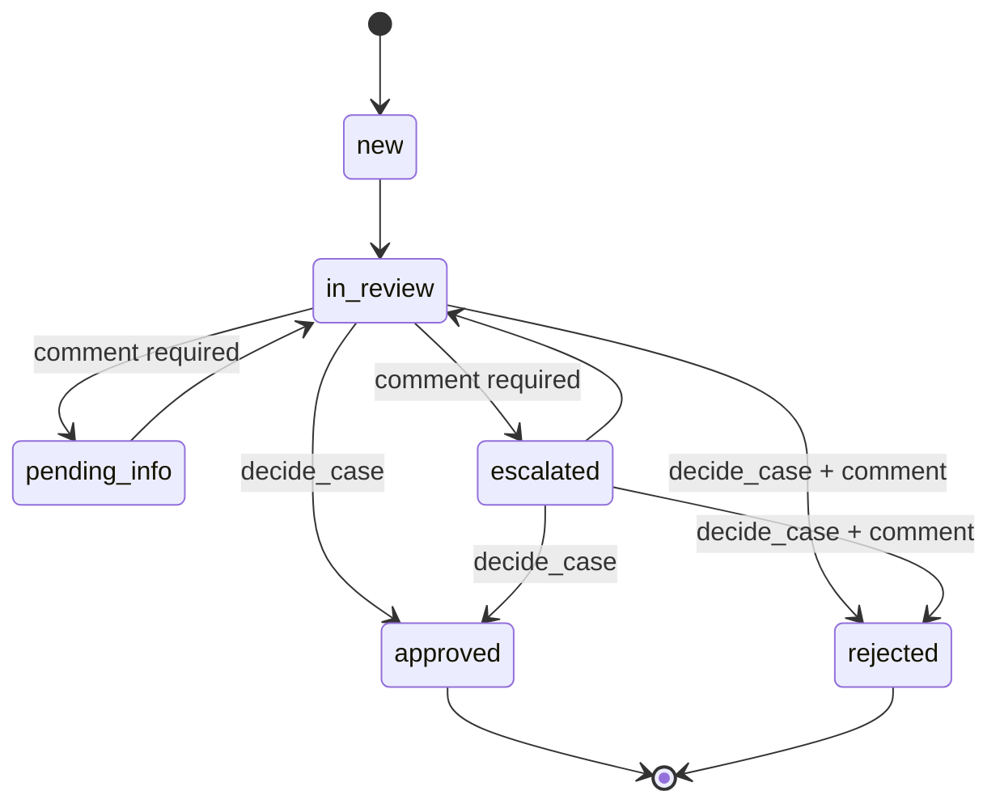

# Architecture

Ops Apps is a single Django project that hosts many small internal apps (replacements for
Microsoft Power Apps). Each Power App becomes a Django app under `apps/`, sharing one
database, one login, one look and feel, and one deployment.

## Guiding principles

- **Boring, server-rendered stack.** Django templates + Bootstrap 5. No SPA, no build step,
  no Node. Add [htmx](https://htmx.org) for in-page interactivity when a screen needs it.
- **One deployable, one database.** A modular monolith: apps are isolated by package, not by
  service. Postgres is the only stateful dependency.
- **No infrastructure until it's needed.** No Redis, Celery, or caches yet. When we need
  background work, start with a Postgres-backed queue (e.g. Django 6's tasks framework or
  `django-q2` on the ORM broker) before adding Redis.
- **Business rules live in `services.py`.** Views parse input and render output; they never
  change state directly. This keeps rules testable and auditable and makes a future API or
  import job reuse the same code paths.
- **Everything auditable.** State changes are recorded in append-only event tables.
- **Twelve-factor config.** All environment-specific settings come from env vars
  (`.env.example`). One `config/settings.py`, no per-environment settings modules.

## Stack

| Concern | Choice | Notes |
| --- | --- | --- |
| Language / runtime | Python 3.13, managed by [uv](https://docs.astral.sh/uv/) | `uv.lock` is the source of truth |
| Framework | Django 5.2 LTS | Supported until April 2028 |
| Database | PostgreSQL 17 via `psycopg` 3 | `DATABASE_URL` env var |
| UI | Django templates, Bootstrap 5.3 (vendored in `static/vendor`), `django-crispy-forms` | No CDN dependency, CSP-friendly |
| Static files | WhiteNoise | No separate static file server needed |
| App server | Gunicorn | Behind the platform's TLS-terminating proxy |
| Auth | Django auth + groups/permissions | SSO (Entra ID / OIDC) planned, see below |
| File uploads | Django storage API, local filesystem today | Swap to Azure Blob / S3 via `django-storages` by changing `STORAGES` |
| Tests | pytest + pytest-django + factory_boy | Run against real Postgres |
| Lint / format | Ruff, enforced by pre-commit and CI | |
| CI | GitHub Actions with a Postgres service container | |

## Layout

```
config/            Project settings, root URLconf, WSGI/ASGI
apps/
  core/            Shared building blocks: base models, home/launcher page, health check
  kyc/             KYC review queue (first Power Apps replacement)
  refunds/         Refund request / approval / payment workflow + dashboard
  flags/           Feature-flag admin panel + read-only JSON API
    models.py      Data model
    services.py    Business rules / state machine (the only place that mutates cases)
    forms.py       Input validation
    views.py       Thin HTTP layer
    roles.py       Default groups + permissions, synced after `migrate`
    launcher.py    `tile(user)`: the app's home-page tile, or None without access
    templates/kyc/ App templates
    tests/
templates/         Project-wide templates (base layout, navbar, login)
static/            Project-wide CSS and vendored Bootstrap
docs/              This file and future ADRs
```

Adding a new app: `uv run python manage.py startapp <name> apps/<name>`, set
`name = "apps.<name>"` in its `AppConfig`, add it to `INSTALLED_APPS`, mount its URLs in
`config/urls.py` under its own prefix, add a nav link, add a `launcher.tile` to
`apps/core/views.py:TILE_PROVIDERS`, and define its groups in a `roles.py` (using
`apps.core.roles.sync_roles`). Shared helpers live in `apps/core` (`forms.users_with_perm`,
`templatetags/ui_tags`, `demo` for seed commands).

## Security model

- Every view requires login (`LoginRequiredMiddleware`); public endpoints opt out explicitly
  (only `/healthz/` and the login page today).
- Authorization is Django permissions granted via groups. Each app ships default groups
  (e.g. `KYC Reviewer`, `KYC Approver`) created/updated on `migrate`. Admins assign users to
  groups in `/admin/`.
- Uploaded documents are **never** served from a public media URL; they are streamed through a
  permission-checked view.
- Production hardening (secure cookies, HSTS, SSL redirect) is driven by env vars and verified
  in CI with `manage.py check --deploy`.

## KYC review queue

### Data model

- **Customer**: the party being reviewed. `external_ref` links to the source system (CRM /
  core banking); creating a case with a known `external_ref` reuses the existing customer.
- **ReviewCase**: one KYC review. Status, risk rating, review type, due date, assignee, and
  who/when decided.
- **CaseDocument**: uploaded evidence (passport, proof of address, ...).
- **CaseEvent**: append-only audit trail of creation, assignment, status changes, comments,
  and uploads.

### Workflow



- Moving a case to *In review* auto-assigns it to the reviewer if unassigned.
- Approve/reject requires the `kyc.decide_case` permission (`KYC Approver` group).
- Approving a **high-risk** case additionally requires `kyc.approve_high_risk`.
- State changes use `SELECT ... FOR UPDATE` so two reviewers can't act on a case at once.

### Screens

- **Queue** (`/kyc/`): tabs for *Assigned to me*, *Unassigned*, *All open*, *Closed*, with
  search (name, `KYC-000123`, external ref), status/risk filters, overdue highlighting, and
  pagination. Sorted by due date.
- **Case detail** (`/kyc/cases/<id>/`): customer info, documents, activity timeline, comment
  box, status transition form limited to what the current user may do, reassignment.
- **New case** (`/kyc/cases/new/`): manual intake of customer + review details.

## Refunds

### Data model
- **Refund**: customer name/ref, order ref, amount (`Decimal`, single currency set by
  `REFUND_CURRENCY`), reason code, description, status, requester, decider, payer, payment ref.
- **RefundEvent**: append-only audit trail (created, status change, comment); `PROTECT`ed.

### Workflow
```
requested ──► approved ──► paid
    │            │
    ├──► rejected└──► cancelled
    └──► cancelled
```
- Four-eyes: nobody approves or rejects a refund they requested.
- Amounts above `REFUND_APPROVAL_LIMIT` need `approve_over_limit` (**Refunds Senior Approver**).
- Only **Refunds Finance** (`mark_paid`) marks approved refunds paid, with a payment reference.
- Reject/cancel need a comment. Requesters may cancel their own refunds while still requested.
- Groups: **Refunds Requester**, **Refunds Approver**, **Refunds Senior Approver**, **Refunds Finance**.
- Payment itself happens outside this app; the app records the reference.

### Screens
- **Dashboard** (`/refunds/`): totals pending / awaiting payment / paid (30d), approval rate,
  30-day breakdown by reason, pending aging, and the user's own work lists.
- **All refunds** (`/refunds/all/`): tabs by status, search by customer/RF-number/refs, reason filter.
- **Detail** and **New refund**. Django admin is read-only for refunds.

## Feature flags

### Data model
- **FeatureFlag**: immutable `key`, name, description, owner, `enabled` master switch,
  `rollout_percentage` (0–100), `targets` (Postgres array of user/customer IDs), `is_archived`.
- **FlagChange**: append-only history with a field-level `{field: [old, new]}` diff and comment.
- **ApiClient**: named service credentials; only a SHA-256 hash of the token is stored.

### Evaluation
Off if not `enabled` or archived; on for everyone at 100%; otherwise on for listed targets and
for targets whose stable bucket `sha256("<key>:<target>") % 100` is below the percentage.
Raising the percentage only adds targets. Without a target, partial flags evaluate to off.

### Screens and API
- **Flags** (`/flags/`): state filter, search, one-click on/off. **Detail**: edit form, target
  checker, change history, archive/restore. Groups: **Flags Viewer**, **Flags Editor**.
- **API** (`/flags/api/v1/flags/`, `/flags/api/v1/flags/<key>/?target=`): GET only, bearer token.
  Django admin is read-only for flags; API clients are managed there.

## Roadmap / open decisions

1. **SSO**: Microsoft Entra ID via OIDC (`mozilla-django-oidc` or `django-allauth`), mapping
   Entra groups to Django groups. Local passwords stay for break-glass admin only.
2. **Hosting**: any container platform works (the `Dockerfile` is production-ready). Azure
   Container Apps / App Service + Azure Database for PostgreSQL fits an M365 shop.
3. **Document storage**: Azure Blob or S3 via `django-storages` once hosted.
4. **Data migration** from the Power Apps data source (Dataverse / SharePoint lists) via a
   one-off management command that writes through `services.py`.
5. **Intake integrations**: an API or scheduled import to create cases from upstream systems.
6. **Interactivity**: htmx for inline updates (e.g. claim from the queue without a reload).
