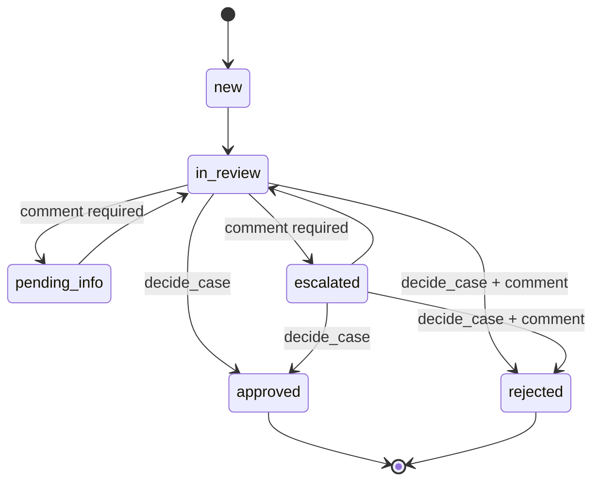

# Architecture

Ops Apps is a single Django project that hosts many small internal apps (replacements for
Microsoft Power Apps). Each Power App becomes a Django app under `apps/`, sharing one
database, one login, one look and feel, and one deployment.

## Guiding principles

- **Boring, server-rendered stack.** Django templates + Bootstrap 5. No SPA, no build step,
  no Node. Add [htmx](https://htmx.org) for in-page interactivity when a screen needs it.
- **One deployable, one database.** A modular monolith: apps are isolated by package, not by
  service. Postgres is the only stateful dependency.
- **No infrastructure until it's needed.** No Redis, Celery, or caches yet. When we need
  background work, start with a Postgres-backed queue (e.g. Django 6's tasks framework or
  `django-q2` on the ORM broker) before adding Redis.
- **Business rules live in `services.py`.** Views parse input and render output; they never
  change state directly. This keeps rules testable and auditable and makes a future API or
  import job reuse the same code paths.
- **Everything auditable.** State changes are recorded in append-only event tables.
- **Twelve-factor config.** All environment-specific settings come from env vars
  (`.env.example`). One `config/settings.py`, no per-environment settings modules.

## Stack

| Concern | Choice | Notes |
| --- | --- | --- |
| Language / runtime | Python 3.13, managed by [uv](https://docs.astral.sh/uv/) | `uv.lock` is the source of truth |
| Framework | Django 5.2 LTS | Supported until April 2028 |
| Database | PostgreSQL 17 via `psycopg` 3 | `DATABASE_URL` env var |
| UI | Django templates, Bootstrap 5.3 (vendored in `static/vendor`), `django-crispy-forms` | No CDN dependency, CSP-friendly |
| Static files | WhiteNoise | No separate static file server needed |
| App server | Gunicorn | Behind the platform's TLS-terminating proxy |
| Auth | Django auth + groups/permissions | SSO (Entra ID / OIDC) planned, see below |
| File uploads | Django storage API, local filesystem today | Swap to Azure Blob / S3 via `django-storages` by changing `STORAGES` |
| Tests | pytest + pytest-django + factory_boy | Run against real Postgres |
| Lint / format | Ruff, enforced by pre-commit and CI | |
| CI | GitHub Actions with a Postgres service container | |

## Layout

```
config/            Project settings, root URLconf, WSGI/ASGI
apps/
  core/            Shared building blocks: base models, home/launcher page, health check
  kyc/             KYC review queue (first Power Apps replacement)
  refunds/         Refund request / approval / payment workflow + dashboard
  flags/           Feature-flag admin panel + read-only JSON API
    models.py      Data model
    services.py    Business rules / state machine (the only place that mutates cases)
    forms.py       Input validation
    views.py       Thin HTTP layer
    roles.py       Default groups + permissions, synced after `migrate`
    launcher.py    `tile(user)`: the app's home-page tile, or None without access
    templates/kyc/ App templates
    tests/
templates/         Project-wide templates (base layout, navbar, login)
static/            Project-wide CSS and vendored Bootstrap
docs/              This file and future ADRs
```

### Adding a new app

```bash
uv run python manage.py startopsapp vendor_onboarding --model VendorRequest --title "Vendor Onboarding"
uv run python manage.py migrate
uv run pytest apps/vendor_onboarding
```

`startopsapp` renders `apps/core/app_template/` into `apps/<label>/` and registers it: it
appends the app to `OPS_APPS` in `config/settings.py` and makes the first migration. The
generated app is a working, tested workflow you then reshape to the real Power App:

- `models.py`: a main model (title / description / status / owner) plus an append-only
  `<Model>Event` audit table (`on_delete=PROTECT`).
- `services.py`: the only code that mutates records: create, update (field-level diff),
  status transitions (`TRANSITIONS`), comments. Every change writes an event.
- `roles.py`: `<Title> Viewer` and `<Title> Editor` groups.
- `views.py`, `urls.py`, `forms.py`, `templates/<label>/`: list (search + status filter),
  detail with timeline, create/edit, transition and comment endpoints.
- `admin.py`: read-only, so admin edits can't bypass the audit trail.
- `launcher.py`: the home-page tile. `management/commands/seed_<label>_demo.py`: picked
  up automatically by `seed_demo`.
- `tests/`: service rules, plus access boundaries (anonymous → login, no role → 403 on every
  URL, viewer read-only, editor end-to-end).

CI's `scaffold` job generates a throwaway app and runs its tests and linters, so the
template can't drift from the rest of the codebase.

### How core finds apps

Each app's `AppConfig` subclasses `apps.core.registry.OpsAppConfig` and declares
`nav_url_name`, `access_permission` and optionally `url_prefix` (default `<label>/`),
`nav_label` and `order`. From that, core:

- mounts `apps.<label>.urls` under the prefix (`config/urls.py: ops_urlpatterns()`),
- shows the navbar link and home tile only to users with `access_permission`
  (`context_processors.ops_nav`, `views.home` calling `launcher.tile(user)`),
- syncs `roles.ROLES` into groups after every `migrate`,
- fails `manage.py check` if an app's config is incomplete (`core.E001`–`E004`).

So adding an app never means editing core, the navbar or the root URLconf. Shared helpers
live in `apps/core` (`forms.users_with_perm`, `templatetags/ui_tags`, `demo` for seed
commands, `tests/factories.UserFactory`).

## Security model

- Every view requires login (`LoginRequiredMiddleware`); public endpoints opt out explicitly
  (only `/healthz/` and the login page today).
- Authorization is Django permissions granted via groups. Each app ships default groups
  (e.g. `KYC Reviewer`, `KYC Approver`) created/updated on `migrate`. Admins assign users to
  groups in `/admin/`.
- Uploaded documents are **never** served from a public media URL; they are streamed through a
  permission-checked view.
- Production hardening (secure cookies, HSTS, SSL redirect) is driven by env vars and verified
  in CI with `manage.py check --deploy`.
- Sessions expire after `SESSION_COOKIE_AGE` seconds idle (default 2h). Password login locks a
  username for `LOGIN_LOCKOUT_MINUTES` after `LOGIN_LOCKOUT_ATTEMPTS` failures (default 5 in 15m),
  counted from the audit log.

### Audit log (`apps/audit`)

One system-wide, append-only `AuditLog` table. Per-app event tables (`CaseEvent`, `RefundEvent`,
`FlagChange`, generated `<Model>Event`) stay as each record's business timeline; `AuditLog` is the
security trail across everything.

| Recorded | How |
|---|---|
| Create / update (field diff) / delete of every model in an ops app, plus `User` and `Group` | `pre_save`/`post_save`/`post_delete` signals; new apps are covered automatically |
| Group membership and group/user permission changes | `m2m_changed` |
| Logins, logouts, failed logins (incl. lockouts) | Django auth signals |
| Views/downloads of sensitive records (KYC cases, documents) | `apps.audit.log.log_view(request, obj)` in the view |
| Token-authenticated API calls | `record(Action.API_ACCESS, ...)` in the API decorator (`AUDIT_API_ACCESS`) |

- Each entry stores actor (plus a username snapshot that survives user deletion), IP, user agent,
  method, path and a request ID. `AuditContextMiddleware` reuses a well-formed upstream
  `X-Request-ID` (e.g. from Azure Front Door) or generates one, and echoes it in the response.
  Set `AUDIT_PROXY_COUNT` to the number of trusted proxies so the client IP is taken from
  `X-Forwarded-For`.
- Fields whose names contain `password`, `secret`, `token`, `api_key`, `private_key` or
  `credential` are logged only as a masked fingerprint.
- A Postgres trigger rejects `UPDATE`/`DELETE` on the table. The only exception is
  `manage.py purge_audit_log`, which deletes entries older than `AUDIT_RETENTION_DAYS`
  (default 365) inside a transaction that sets `audit.allow_purge`, then logs the purge.
  Schedule it daily (e.g. an Azure Container Apps job). The DB owner can still drop the
  trigger; for tamper-evidence beyond that, run the app as a non-owner role or export to WORM storage.
- Browse at `/audit/` (group **Auditor**) or read-only in the admin.

### Access-boundary tests

`apps/core/tests/test_access_boundaries.py` walks every URL in the project (admin excluded) and
asserts: anonymous users are redirected to login, a logged-in user with no roles gets 403/405 on
every app URL (GET and POST), and no app's roles grant access to another app's URLs. New apps
and URLs are covered automatically; anything reachable without a login or without an app role
must be added to the `PUBLIC` / `ANY_AUTHENTICATED` allowlists in that file, which makes the
exception visible in review.

CI also runs Ruff's `S` (bandit) rules and `pip-audit` against the locked dependencies.

## KYC review queue

### Data model

- **Customer**: the party being reviewed. `external_ref` links to the source system (CRM /
  core banking); creating a case with a known `external_ref` reuses the existing customer.
- **ReviewCase**: one KYC review. Status, risk rating, review type, due date, assignee, and
  who/when decided.
- **CaseDocument**: uploaded evidence (passport, proof of address, ...).
- **CaseEvent**: append-only audit trail of creation, assignment, status changes, comments,
  and uploads.

### Workflow



- Moving a case to *In review* auto-assigns it to the reviewer if unassigned.
- Approve/reject requires the `kyc.decide_case` permission (`KYC Approver` group).
- Approving a **high-risk** case additionally requires `kyc.approve_high_risk`.
- State changes use `SELECT ... FOR UPDATE` so two reviewers can't act on a case at once.

### Screens

- **Queue** (`/kyc/`): tabs for *Assigned to me*, *Unassigned*, *All open*, *Closed*, with
  search (name, `KYC-000123`, external ref), status/risk filters, overdue highlighting, and
  pagination. Sorted by due date.
- **Case detail** (`/kyc/cases/<id>/`): customer info, documents, activity timeline, comment
  box, status transition form limited to what the current user may do, reassignment.
- **New case** (`/kyc/cases/new/`): manual intake of customer + review details.

## Refunds

### Data model
- **Refund**: customer name/ref, order ref, amount (`Decimal`, single currency set by
  `REFUND_CURRENCY`), reason code, description, status, requester, decider, payer, payment ref.
- **RefundEvent**: append-only audit trail (created, status change, comment); `PROTECT`ed.

### Workflow
```
requested ──► approved ──► paid
    │            │
    ├──► rejected└──► cancelled
    └──► cancelled
```
- Four-eyes: nobody approves or rejects a refund they requested.
- Amounts above `REFUND_APPROVAL_LIMIT` need `approve_over_limit` (**Refunds Senior Approver**).
- Only **Refunds Finance** (`mark_paid`) marks approved refunds paid, with a payment reference.
- Reject/cancel need a comment. Requesters may cancel their own refunds while still requested.
- Groups: **Refunds Requester**, **Refunds Approver**, **Refunds Senior Approver**, **Refunds Finance**.
- Payment itself happens outside this app; the app records the reference.

### Screens
- **Dashboard** (`/refunds/`): totals pending / awaiting payment / paid (30d), approval rate,
  30-day breakdown by reason, pending aging, and the user's own work lists.
- **All refunds** (`/refunds/all/`): tabs by status, search by customer/RF-number/refs, reason filter.
- **Detail** and **New refund**. Django admin is read-only for refunds.

## Feature flags

### Data model
- **FeatureFlag**: immutable `key`, name, description, owner, `enabled` master switch,
  `rollout_percentage` (0–100), `targets` (Postgres array of user/customer IDs), `is_archived`.
- **FlagChange**: append-only history with a field-level `{field: [old, new]}` diff and comment.
- **ApiClient**: named service credentials; only a SHA-256 hash of the token is stored.

### Evaluation
Off if not `enabled` or archived; on for everyone at 100%; otherwise on for listed targets and
for targets whose stable bucket `sha256("<key>:<target>") % 100` is below the percentage.
Raising the percentage only adds targets. Without a target, partial flags evaluate to off.

### Screens and API
- **Flags** (`/flags/`): state filter, search, one-click on/off. **Detail**: edit form, target
  checker, change history, archive/restore. Groups: **Flags Viewer**, **Flags Editor**.
- **API** (`/flags/api/v1/flags/`, `/flags/api/v1/flags/<key>/?target=`): GET only, bearer token.
  Django admin is read-only for flags; API clients are managed there.

## Integrations (`apps/integrations`)

External systems are registered as data, not code: an `ExternalSystem` row (Django admin)
holds the kind (**Dataverse** or **SharePoint**), the URL, the Entra app's tenant and client
IDs, the *name* of the env var holding its client secret, and an access mode:

- **Read-only**: `Connector.write()` refuses every write (`ReadOnlySystemError`) before any
  HTTP call and logs the attempt as a blocked `external_write` audit entry.
- **Read-write**: writes go through, and each is audited (`external_write`, field names only).

Changing a system's access mode is itself an audited model change. Secrets never live in
the database; on Azure, point the env var at a Key Vault reference.

```python
from apps.integrations.connectors import connect

crm = connect("crm-prod")                      # DataverseConnector
for row in crm.query("contacts", select=["fullname"], filter="statecode eq 0"):
    ...
crm.update("contacts", contact_id, {"jobtitle": "CFO"})   # raises if crm-prod is read-only

sp = connect("ops-sharepoint")                 # SharePointConnector (Microsoft Graph)
for item in sp.items("Vendor List", fields=["Title", "Status"]):
    ...
```

- **Auth**: Entra client-credentials tokens (`credentials.py`), cached in-process until just
  before expiry. Dataverse uses `<env URL>/.default`, SharePoint uses Graph.
- **HTTP**: one `requests` session per connector, per-system timeout (default 30s), and
  retries with backoff on 429/5xx for reads only. Writes are never retried automatically.
- **Guard rails**: URLs must be https on `*.dynamics.com` / `*.sharepoint.com`, so tokens
  can't be sent elsewhere; `@odata.nextLink` must stay on the same host; entity set names,
  record GUIDs and list item IDs are validated before they go into a URL. Remote errors are
  raised as `RemoteError` with the OData/Graph error code and message only.

### Importers (scheduled pulls)

Each app can define `importers.py` (generated apps get an empty one):

```python
from apps.integrations.sync import Importer, Result

class DataverseCaseImporter(Importer):
    name = "kyc.dataverse_cases"
    system = "crm-prod"

    def fetch(self, connector):
        return connector.query("cr123_kyccases", filter="statecode eq 0")

    def apply(self, record):          # own transaction; call services.py, return a Result
        ...
        return Result.CREATED

IMPORTERS = [DataverseCaseImporter]
```

`manage.py run_import <name>` / `--all` / `--list` runs them. Each run writes a `SyncRun`
(fetched / created / updated / unchanged / failed, first 50 errors); one bad record doesn't
stop the run, and the command exits non-zero unless every run fully succeeded, so the
scheduler can alert. Audit entries written during an import are attributed to
`import:<name>`. `manage.py check_integration <slug>` tests credentials and connectivity.

On Azure, schedule `run_import --all` (and `purge_audit_log`) as Container Apps jobs using
the same image. **Integrations Viewer** sees systems and runs at `/integrations/`;
**Integrations Admin** (plus `is_staff`) registers and edits systems in the admin.
Adding another kind of system means a new `Connector` subclass and a `Kind` choice.

## Roadmap / open decisions

1. **SSO**: Microsoft Entra ID via OIDC (`mozilla-django-oidc` or `django-allauth`), mapping
   Entra groups to Django groups. Local passwords stay for break-glass admin only.
2. **Hosting**: any container platform works (the `Dockerfile` is production-ready). Azure
   Container Apps / App Service + Azure Database for PostgreSQL fits an M365 shop.
3. **Document storage**: Azure Blob or S3 via `django-storages` once hosted.
4. **Data migration** from the Power Apps data source: an `Importer` per app (see
   Integrations) once the real Dataverse tables / SharePoint lists are known.
5. **Managed identity**: swap the Entra client secret for the Container App's managed
   identity once hosted on Azure.
6. **Interactivity**: htmx for inline updates (e.g. claim from the queue without a reload).
